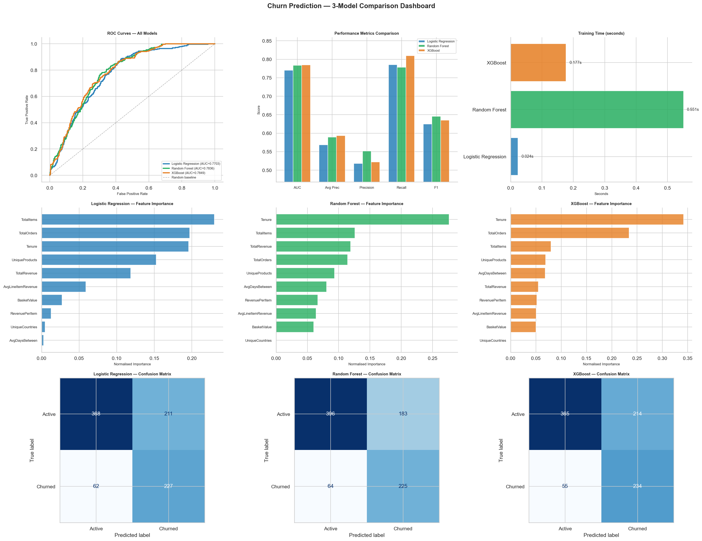

# Customer Inactivity Classification

**An experimental machine-learning case study using retail customer behavior**

This project compares three classification models to learn which purchasing patterns are associated with customers being inactive at the end of a historical retail dataset.

## Recruiter quick view

| Item | Result |
| --- | --- |
| Transactions analyzed | **397,924** |
| Customers scored | **4,338** |
| Models compared | Logistic Regression, Random Forest and XGBoost |
| Best test AUC | **0.785** |
| Best recall | **80.97%** |

## The business question

Retail teams need a consistent way to review large customer lists and decide where deeper retention analysis may be useful.

This project asks:

**Which customer behavior patterns are associated with inactivity in this historical dataset?**

Each customer receives a model score and is grouped into a high-, medium- or low-risk tier for analysis.

## What the results mean in plain English

| Metric | Plain-English meaning |
| --- | --- |
| **AUC: 0.785** | The selected model usually ranks an inactive customer above an active customer; 0.50 would be random ranking. |
| **Recall: 80.97%** | The model identifies about four out of every five customers labelled inactive in the test sample. |
| **Precision: 52.23%** | About one in two customers flagged by the model has the inactive label, so outreach would still require business judgment. |

## Model comparison

| Model | Test AUC | Recall | What it adds |
| --- | ---: | ---: | --- |
| Logistic Regression | 0.770 | 78.55% | A simple, explainable baseline |
| Random Forest | 0.784 | 77.85% | Captures more complex behavior patterns |
| **XGBoost** | **0.785** | **80.97%** | Best balance for ranking and identifying inactive customers |

## Customer information used

The model summarizes each customer's transaction history into practical measures such as:

- Total revenue and total orders
- Items purchased and average basket value
- Number of unique products
- Customer tenure
- Typical number of days between purchases

The direct recency value is intentionally excluded because the inactivity label itself is defined from recency. Including it would give the model the answer instead of testing whether other behavior patterns contain useful information.

## How the project works

1. Clean the public UK retail transactions.
2. Summarize purchases into one row per customer.
3. Label a customer inactive when the final recorded purchase is more than 90 days before the dataset end date.
4. Split customers into training and test samples.
5. Compare three models with the same evaluation measures.
6. Convert model scores into simple risk tiers for interpretation.

## Important limitation

This is a **retrospective inactivity-classification project**, not a proven forecast of future churn.

The label and customer features are created from the same historical dataset snapshot. Before using this approach operationally, the next version should create features at an earlier date and evaluate them against a completely later time period.

Financial examples in the notebook are scenarios based on assumptions; they are not measured revenue savings or real campaign results.

Making these limits explicit is part of responsible analysis.

## Business use

With a proper future-period validation, this type of workflow could support:

- Prioritizing customers for retention review
- Comparing targeted outreach with broad campaigns
- Monitoring changes in customer engagement
- Testing which customer signals are most useful for follow-up

## What this project demonstrates

- Translating a business question into an analytical target
- Customer-level feature engineering
- Comparing models instead of presenting only one result
- Explaining model metrics for non-technical stakeholders
- Recognizing data leakage and validation limitations
- Connecting analytical output to a practical workflow

## Dataset and tools

Data: [UCI Online Retail dataset](https://archive.ics.uci.edu/ml/datasets/Online+Retail), covering UK e-commerce transactions from 2010–2011.

Tools: **Python · Pandas · scikit-learn · XGBoost · Jupyter Notebook · Matplotlib**
